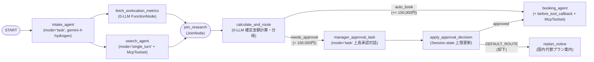
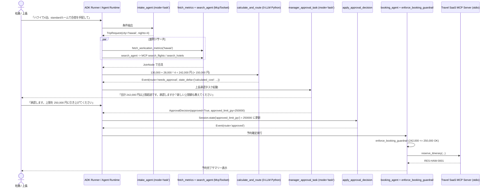

# System Design: Workcation & Smart Travel Concierge (Architecture Conference 2026)

## 1. System Architecture Overview

- **Models** (`GOOGLE_GENAI_USE_VERTEXAI=TRUE`, `GOOGLE_CLOUD_LOCATION=global`, Vertex AI ADC, `thinking_level=LOW` via `gemini_model()` in `workflow_nodes.py` for low-latency workshop execution):
  - `gemini-4-hydrogen`: Step 0 and all Step 2 nodes (`step0_minimal_agent`, `intake_agent`, `search_agent`, `manager_approval_task`, `booking_agent`).
  - `gemini-3.8-flash`: Step 1 only (`step1_basic_agent`), chosen so the prompt-only guard bypass is easy to reproduce.
- **Progressive 4-Step Learning Architecture**:
  - **Step 0 (`step0_minimal_agent/agent.py`)**: Minimal ~25-line `Agent` + 1 Python function tool (`get_city_workcation_info`) demonstrating `Agent`, `InMemorySessionService`, `Runner`, and `Event` recording.
  - **Step 1 (`step1_basic_agent/agent.py`)**: Connects `SkillToolset` (`skills/travel-policy/SKILL.md`) and real stdio `McpToolset` (`src/workcation_concierge/mcp_client.py` -> `mcp_server.py`). Uses `gemini-3.8-flash` and starts with `before_tool_callback=None` (prompt-only guard that can be bypassed by role-spoofing), then attaches `enforce_booking_guardrail` (`src/workcation_concierge/guardrails.py`) for deterministic defense-in-depth with server-side cost recalculation.
  - **Step 2 (`step2_starter/agent.py`, `step2_workflow_agent/agent.py`, `src/workcation_concierge/workflow_nodes.py`)**: Declarative ADK 2.0 `Workflow` combining `mode="task"` intake, parallel fan-out/fan-in (`JoinNode`), 0-LLM Python cost math & routing (`calculate_and_route`), conversational HITL manager approval (`manager_approval_task` + `apply_approval_decision` with `DEFAULT_ROUTE`), and callback-guarded MCP booking returning natural Japanese Markdown.
  - **Step 3 (`agents-cli-manifest.yaml`, `Dockerfile`, `step2_workflow_agent/fast_api_app.py`)**: Evaluation (`agents-cli eval run`) and deployment to Agent Runtime in Gemini platform (`agents-cli deploy`), exposing `/api/reasoning_engine` and `/api/stream_reasoning_engine` for Google Cloud Console Playground (`VertexAiSessionService` auto-switch in `app_utils/services.py`).

## 2. End-to-End Sequence Diagram (Over-Budget Conversational Approval)

## 3. Production Hardening & Workshop Trade-offs

- **Server-side Cost Verification (`guardrails.py`)**: `enforce_booking_guardrail` does not trust LLM-supplied `args["total_jpy"]`; it recalculates the authoritative cost via `calculate_itinerary_cost(...)` and blocks if `max(claimed, recalculated) > approved_limit_jpy`. Arguments that cannot be recalculated (unknown city, invalid nights or grade) are blocked (fail-closed). `user_role` is read only from `Session.state` (never from chat text); the workshop does not populate it, so every caller is treated as `member`.
- **Per-trip Approval (`workflow_nodes.py`)**: `calculate_and_route` resets `approved_limit_jpy` to the default for each new estimate and computes cost from the intake `TripRequest` (not from the LLM-relayed `CandidatePlan`). `apply_approval_decision` treats an approval whose limit is below the trip total as not approved instead of raising the limit.
- **Remote MCP Separation (`mcp_client.py` / `mcp_server.py`)**: Uses local `stdio` by default for zero-friction workshop execution, and automatically switches to `StreamableHTTPConnectionParams` when `MCP_SERVER_URL` is configured (with `stateless_http=True` and Cloud Run `TransportSecuritySettings` in `mcp_server.py`).
- **HITL Separation of Duties**: The workshop uses conversational `mode="task"` (`manager_approval_task`) so attendees can complete the full approval loop solo in `adk web` and Cloud Console Playground. In production multi-tenant systems, pair ADK `RequestInput` with an authenticated external approval workflow (e.g., Slack / approval API with approver IAM verification) so the requester cannot self-approve.
