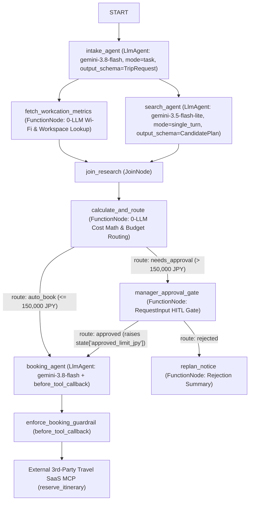
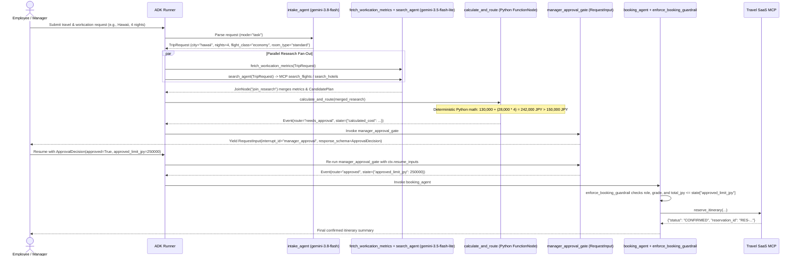

# System Design: Workcation & Smart Travel Concierge (Architecture Conference 2026)

## 1. System Architecture Overview

### Purpose & Scope
- **Objective**: Provide a hands-on reference architecture demonstrating how to evolve from a single LLM agent with deterministic client-side guardrails (Step 1) to a production-grade Google ADK 2.0 hybrid graph `Workflow` (Step 2) and continuous evaluation/deployment lifecycle (Step 3).
- **Models**:
  - `gemini-3.8-flash`: Complex multi-turn intake (`mode="task"`), policy reasoning, and booking summary synthesis.
  - `gemini-3.5-flash-lite`: High-speed single-turn candidate flight/hotel extraction (`mode="single_turn"`).
- **Authentication**: Vertex AI Application Default Credentials (`GOOGLE_GENAI_USE_VERTEXAI=TRUE`, `gcloud auth application-default login`). Raw Gemini API keys are never used.

### Step 1 vs. Step 2 Architecture

#### Step 1: Single Agent + Deterministic Guardrail (`step1_basic_agent/agent.py`)
In Step 1, a single `LlmAgent` (`gemini-3.8-flash`) orchestrates corporate travel policy lookup via `SkillToolset` (`skills/travel-policy/SKILL.md`), flight/hotel search, cost calculation, and booking reservation against an external Travel SaaS MCP toolset (`src/workcation_concierge/mcp_server.py`). A deterministic `before_tool_callback` (`enforce_booking_guardrail` in `src/workcation_concierge/guardrails.py`) intercepts `reserve_itinerary` before execution.

#### Step 2: ADK 2.0 Hybrid Graph `Workflow` (`step2_workflow_agent/agent.py`)
In Step 2, orchestration is refactored into a declarative ADK 2.0 `Workflow` combining LLM agent nodes, parallel fan-out/fan-in (`JoinNode`), zero-LLM deterministic Python calculation/routing (`FunctionNode`), and a Human-in-the-Loop (`RequestInput`) manager approval gate.



---

## 2. End-to-End Sequence Diagram



---

## 3. Trust Boundary & Architectural Rationale

### 3.1 Why External 3rd-Party Travel SaaS MCP Requires Client-Side `before_tool_callback`
The Travel SaaS MCP server (`src/workcation_concierge/mcp_server.py`) represents an external, multi-tenant third-party booking service (such as a commercial GDS or travel portal). It validates inventory and pricing, but it has **no awareness of our company's internal HR grades, role hierarchy, or dynamic session approval state**. Relying on prompt instructions alone ("Do not book business class or exceed 150,000 JPY") is vulnerable to prompt injection or LLM hallucination. Therefore, `enforce_booking_guardrail` (`before_tool_callback`) enforces corporate compliance deterministically on the client side before the MCP tool call ever leaves the trust boundary.

### 3.2 Why Cost Math and Routing Live in a Deterministic Python Node (`calculate_and_route`)
LLMs should not be trusted with arithmetic or threshold comparisons that gate financial transactions. In Step 2, `calculate_and_route` is a pure Python `FunctionNode` (0 LLM tokens, 0 latency variance) that calls `calculate_itinerary_cost` deterministically, writes the exact breakdown into `Session.state["calculated_cost"]`, and emits `Event(route="auto_book")` when `total_jpy <= approved_limit_jpy` (default `150000`) or `Event(route="needs_approval")` when `total_jpy > approved_limit_jpy`.

### 3.3 How `RequestInput` Updates `Session.state["approved_limit_jpy"]`
When `calculate_and_route` routes to `needs_approval`, `manager_approval_gate` (`FunctionNode(..., rerun_on_resume=True)`) yields `RequestInput(interrupt_id="manager_approval", response_schema=ApprovalDecision)`. ADK pauses the workflow and emits an `adk_request_input` function call event. When the manager responds with `ApprovalDecision(approved=True, approved_limit_jpy=250000, approver_comment="...")`, `manager_approval_gate` resumes, reads `ctx.resume_inputs["manager_approval"]`, and emits:
```python
Event(
    output=payload,
    route="approved",
    state={"approved_limit_jpy": new_limit, "approval_decision": decision_dict},
)
```
When `booking_agent` subsequently calls `reserve_itinerary`, `enforce_booking_guardrail` reads the updated `tool_context.state["approved_limit_jpy"]` (`250000`) and allows the `242,000 JPY` Hawaii standard-grade booking while still blocking any `suite` or `business` class upgrade for `user_role="member"`.

---

## 4. Tool & Session State Contracts

### 4.1 Session State Keys

| State Key | Type | Default | Description |
| :--- | :--- | :--- | :--- |
| `user_role` | `str` | `"member"` | Employee role (`"member"` or `"executive"`). Non-executives cannot book `business` flights or `suite` hotels. |
| `approved_limit_jpy` | `int` | `150000` | Maximum allowed total itinerary cost in JPY. Dynamically raised by `manager_approval_gate` upon manager approval. |
| `trip_request` | `dict` | `{}` | Validated `TripRequest` dictionary stored by the workflow. |
| `calculated_cost` | `dict` | `{}` | Exact cost breakdown (`flight_jpy`, `hotel_total_jpy`, `total_jpy`) computed by `calculate_and_route`. |
| `approval_decision` | `dict` | `{}` | Manager approval payload recorded by `manager_approval_gate`. |

### 4.2 MCP & Deterministic Catalog Tools (`src/workcation_concierge/mcp_server.py`)

| Tool Name | Inputs | Output Schema | Behavior & Catalog Coverage |
| :--- | :--- | :--- | :--- |
| `search_flights` | `city: str` | `{"status": "ok" \| "error", "city": str, "flights": list[dict]}` | Returns economy and business round-trip options for `sapporo`, `okinawa`, `hawaii`, `san_francisco`. |
| `search_hotels` | `city: str` | `{"status": "ok" \| "error", "city": str, "hotels": list[dict]}` | Returns standard and suite hotels with nightly JPY rates and Wi-Fi speeds. |
| `fetch_workcation_metrics` | `city: str` | `{"status": "ok" \| "error", "city": str, "wifi_mbps": int, "coworking_spaces": int, "timezone_offset": str}` | Returns deterministic workcation readiness metrics (e.g., network speed >= 50 Mbps). |
| `calculate_itinerary_cost` | `city: str, nights: int, flight_class: str = "economy", room_type: str = "standard"` | `{"status": "ok" \| "error", "city": str, "nights": int, "flight_jpy": int, "hotel_per_night_jpy": int, "hotel_total_jpy": int, "total_jpy": int}` | Deterministic Python arithmetic: `sapporo` (2 nights = 59,000 JPY), `okinawa` (3 nights = 93,000 JPY), `hawaii` (4 nights = 242,000 JPY), `san_francisco` (4 nights = 320,000 JPY). |
| `reserve_itinerary` | `city: str, nights: int, flight_class: str, room_type: str, total_jpy: int, purpose: str = "workcation"` | `{"status": "CONFIRMED" \| "BLOCKED", "reservation_id": str, ...}` | Protected by `enforce_booking_guardrail` (`before_tool_callback`). |

---

## 5. Acceptance Scenarios & Test Mapping

1. **Catalog & Deterministic Math (`tests/unit/test_mcp_catalog.py`)**:
   - `sapporo` 2 nights (`economy` + `standard`) equals `59,000 JPY` (`<= 150,000 JPY`).
   - `okinawa` 3 nights (`economy` + `standard`) equals `93,000 JPY` (`<= 150,000 JPY`).
   - `hawaii` 4 nights (`economy` + `standard`) equals `242,000 JPY` (`> 150,000 JPY`).
2. **Client-Side Callback Guardrail (`tests/unit/test_guardrails.py`)**:
   - `room_type="suite"` or `flight_class="business"` is 100% blocked for `user_role="member"`.
   - `total_jpy > state["approved_limit_jpy"]` (default `150,000 JPY`) is 100% blocked.
   - Raising `state["approved_limit_jpy"]` to `250,000 JPY` allows a `242,000 JPY` `standard` + `economy` booking to succeed.
3. **Workflow Nodes & HITL Gate (`tests/unit/test_workflow_nodes.py`)**:
   - `calculate_and_route` returns `Event(route="auto_book")` for `<= 150,000 JPY` and `Event(route="needs_approval")` for `> 150,000 JPY`.
   - `manager_approval_gate` yields `RequestInput` when `ctx.resume_inputs` is empty and emits `Event(route="approved", state={"approved_limit_jpy": ...})` when approved.
4. **End-to-End Agent & Workflow Wiring (`tests/integration/test_agents_wiring.py`)**:
   - `step1_basic_agent.agent.root_agent`, `step2_starter.agent.root_agent`, and `step2_workflow_agent.agent.root_agent` initialize cleanly and execute deterministic workflow paths via `InMemoryRunner`.

---

## 6. Local Setup & Verification

```bash
gcloud auth application-default login
cp .env_example .env
uv sync --dev --index https://pypi.org/simple --python /usr/bin/python3.13
uv run --no-sync --python /usr/bin/python3.13 pytest
uv run --no-sync --python /usr/bin/python3.13 ruff format --check .
uv run --no-sync --python /usr/bin/python3.13 ruff check .
uv run --no-sync --python /usr/bin/python3.13 ty check
```
